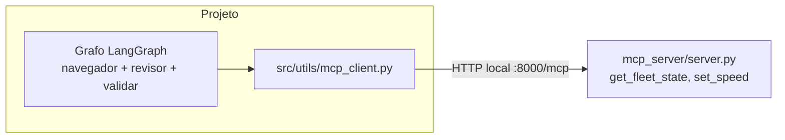
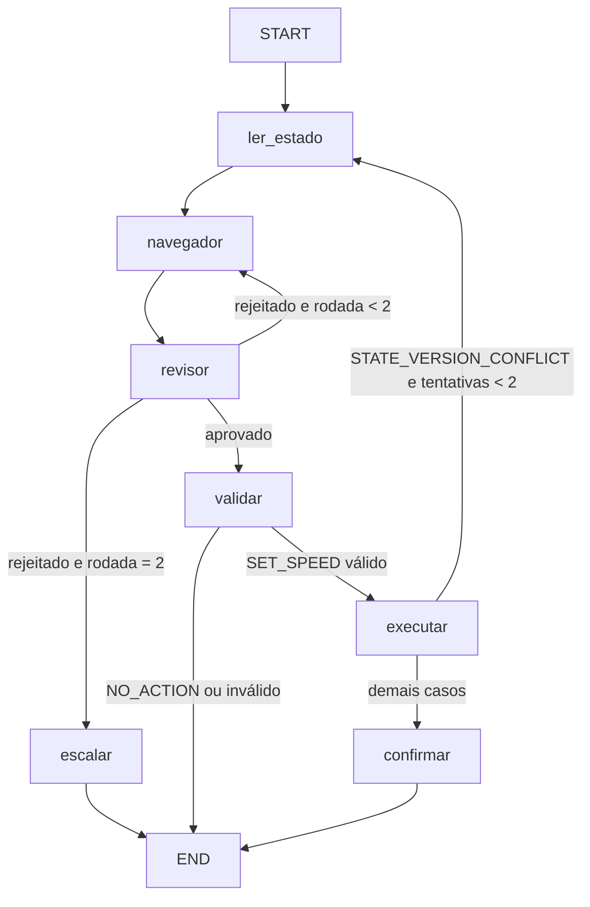

# Semana 2 — Exercício 2: Controle de Frota via Servidor MCP (LangGraph + FastMCP)

Resolução do **Exercício 2 da Semana 2 (MCP e Multiagente — Parte 2)**.  
Neste projeto, os agentes **Navegador** e **Revisor** deixam apenas de conversar e passam a **agir sobre os navios da frota** através de um **Servidor MCP (Model Context Protocol)**, garantindo **controle de concorrência (`expected_state_version`)**, **idempotência (`idempotency_key`)** e **validação determinística em código**.

---

## Arquitetura e Fluxo

A cadeia técnica segue o desenho:

```text
telemetria → agentes (LangGraph) → servidor MCP (FastMCP) → estado da frota
```



### Grafo de Execução (`LangGraph`)



| Nó | Tipo | Responsabilidade |
|---|---|---|
| `ler_estado` | Tool MCP | Chama `get_fleet_state` no servidor MCP e carrega o navio com sua `state_version` atual |
| `navegador` | Agente (LLM) | Propõe a velocidade-alvo (`SET_SPEED` ou `NO_ACTION`) com base nas regras de rota e tempestade |
| `revisor` | Agente (LLM) | Audita a proposta do navegador e aprova ou rejeita com justificativa |
| `validar` | Código | Valida de forma determinística a faixa (`0` a `18` nós), o passo (`0.5`) e os limites em tempestade (`12` nós na rota direta, `15` nós na protegida) |
| `executar` | Tool MCP | Envia `set_speed` ao servidor MCP com `expected_state_version` e `idempotency_key` |
| `confirmar` | Código | Formata a confirmação da mudança de velocidade ou a mensagem de erro retornada pelo servidor |
| `escalar` | Código | Encerra sem ação caso não haja consenso entre Navegador e Revisor após o limite de rodadas |

---

## Estrutura do Projeto

```text
├── data/
│   └── situacao_tempestade.json   # Estado inicial dos navios (S1-FAROL, S2-MARE, S3-CORAL)
├── mcp_server/
│   └── server.py                  # Servidor MCP (FastMCP) com get_fleet_state e set_speed
├── scripts/
│   └── testar_mcp.py              # Bateria de testes diretos das tools MCP (sem LLM)
├── src/
│   ├── app/
│   │   └── main.py                # Ponto de entrada que executa o grafo para os 3 navios
│   ├── graph/
│   │   ├── builder.py             # Montagem do StateGraph
│   │   ├── routing.py             # Regras de transição condicional
│   │   ├── state.py               # Definição do State compartilhado
│   │   ├── nodes/                 # Nós do grafo (ler_estado, navegador, revisor, validar, executar, confirmar, escalar)
│   │   └── prompt/                # System prompts do Navegador e do Revisor
│   └── utils/
│       ├── llmadapter.py          # Configuração do cliente AzureChatOpenAI
│       └── mcp_client.py          # Cliente MCPAdapter e parser de resultados
└── requirements.txt
```

---

## Pré-requisitos e Instalação

1. Crie e ative o ambiente virtual:
   ```powershell
   python -m venv .venv
   .\.venv\Scripts\Activate.ps1
   ```

2. Instale as dependências:
   ```powershell
   pip install -r requirements.txt
   ```

3. Configure o arquivo `.env` na raiz do projeto com as credenciais do Azure OpenAI:
   ```env
   AZURE_OPENAI_API_KEY=sua_chave_aqui
   AZURE_OPENAI_ENDPOINT=https://seu-endpoint.openai.azure.com/
   AZURE_OPENAI_DEPLOYMENT=nome_do_deployment
   AZURE_OPENAI_API_VERSION=2024-08-01-preview
   ```

---

## Como Verificar

A verificação completa está dividida nas 4 partes exigidas pelo exercício.

### 1. Iniciar o Servidor MCP (Parte A)

Em um **terminal separado** (mantenha-o rodando), inicie o servidor MCP:

```powershell
python mcp_server/server.py
```

O servidor ficará escutando em `http://127.0.0.1:8000/mcp`.

---

### 2. Testar as Tools Diretamente sem LLM (Parte B)

Com o servidor recém-iniciado, abra outro terminal na raiz do projeto e execute:

```powershell
python -m scripts.testar_mcp
```

**Resultados esperados nos 4 cenários:**

| # | Chamada | Resultado Esperado | O que prova |
|---|---|---|---|
| **1** | `set_speed("S1-FAROL", 12, 1, "treino:S1-FAROL:SET_SPEED:v1")` | `status: "committed"`, `state_version: 2`, `duplicate: False` | Comando válido altera a velocidade de `14` para `12` e incrementa a versão |
| **2** | Mesma chamada novamente | `status: "committed"`, `state_version: 2`, `duplicate: True` | **Idempotência**: repetir a mesma chave devolve a resposta original sem alterar o estado de novo |
| **3** | `set_speed("S1-FAROL", 11, 1, "outra-chave")` | `error.code: "STATE_VERSION_CONFLICT"` | **Proteção de versão**: rejeita decisões baseadas em versão desatualizada (`1` vs atual `2`) |
| **4** | `set_speed("S1-FAROL", 12.3, 2, "chave-3")` | `error.code: "INVALID_SCHEMA"` | **Validação de contrato**: rejeita velocidades fora do passo permitido de `0.5` nó |

> **Importante:** Após rodar o teste da Parte B, **reinicie o servidor MCP** (`Ctrl + C` e `python mcp_server/server.py`) para restaurar o estado inicial (`state_version = 1`) antes de seguir para a Parte C.

---

### 3. Executar o Grafo Multiagente Completo (Parte C)

Com o servidor MCP recém-iniciado, execute o grafo para os 3 navios da frota:

```powershell
python -m src.app.main
```

**Saída esperada:**

```text
S1-FAROL: velocidade ajustada de 14 para 12.0 nós (state_version 2)
S2-MARE: velocidade ajustada de 16 para 15.0 nós (state_version 2)
S3-CORAL: nenhuma ação necessária
```

- **S1-FAROL** (em tempestade, rota direta): reduzido de `14` para o limite seguro de `12.0` nós (`state_version` vai para `2`).
- **S2-MARE** (em tempestade, rota protegida): reduzido de `16` para o limite seguro de `15.0` nós (`state_version` vai para `2`).
- **S3-CORAL** (fora de tempestade, a `12` nós): recebe `NO_ACTION` e encerra no nó `validar` sem chamar `set_speed`.

---

### 4. Experimento de Conflito de Versão e Recuperação (Parte D)

Para verificar que o grafo se recupera de um `STATE_VERSION_CONFLICT` relendo o estado atualizado (em vez de repetir a mesma chamada às cegas):

1. **Reinicie o servidor MCP** (`python mcp_server/server.py`).
2. No terminal da aplicação, ative a variável `SIMULAR_CONFLITO=1` e execute:

**No PowerShell (Windows):**
```powershell
$env:SIMULAR_CONFLITO="1"
python -m src.app.main
Remove-Item Env:\SIMULAR_CONFLITO
```

**No Bash (Linux/macOS):**
```bash
SIMULAR_CONFLITO=1 python -m src.app.main
```

**O que acontece por baixo dos panos:**
1. Na primeira tentativa (`tentativas == 0`), o nó `executar` envia propositalmente `expected_state_version = state_version - 1` (`0` em vez de `1`).
2. O servidor MCP rejeita com `STATE_VERSION_CONFLICT`.
3. O roteador (`route_after_execute`) detecta o conflito e desvia o fluxo de volta para `ler_estado`.
4. O grafo relê o estado atualizado do servidor, passa novamente pela decisão/validação e conclui na segunda tentativa com `status: "committed"` (`state_version 2`).

---

## Checklist de Verificação

- [x] O servidor roda em um processo separado (`mcp_server/server.py`) e o grafo só o acessa via cliente MCP (`src/utils/mcp_client.py`).
- [x] Os quatro testes da Parte B (`scripts/testar_mcp.py`) passam na ordem esperada.
- [x] O estado do servidor só muda quando o `revisor` aprova **e** a validação determinística em código (`validar`) passa.
- [x] Repetir o mesmo comando com a mesma `idempotency_key` retorna `duplicate: True` e não altera o estado novamente.
- [x] Na Parte D (`SIMULAR_CONFLITO=1`), o grafo captura `STATE_VERSION_CONFLICT`, relê o estado em `ler_estado` e conclui com sucesso na segunda tentativa.
- [x] Nenhum erro é silenciado: qualquer falha retornada pelo servidor MCP é exposta no resultado final pelo nó `confirmar`.
